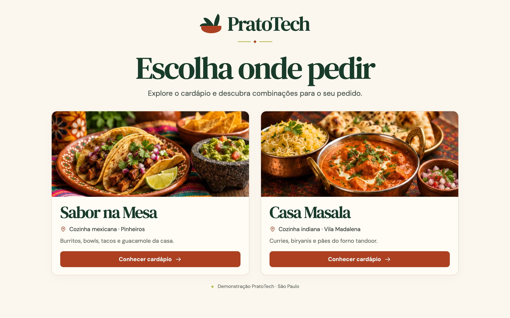
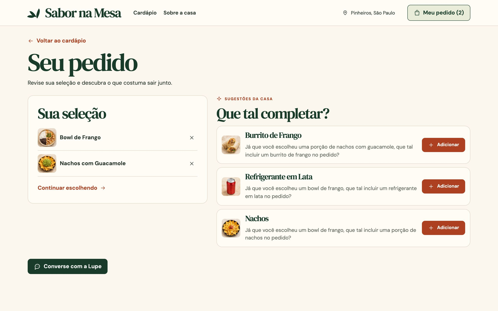

# MVP de recomendação de itens — PratoTech

**Recomendação "compre junto" para delivery**: regras de associação calculadas a partir dos pedidos sugerem o complemento do carrinho com uma frase explicando o porquê, e uma **assistente de conversa em agentes** (orquestrador e analistas com LLM) responde sobre o cardápio, as combinações e a loja, sempre com os dados do restaurante.

**[Abrir o site no ar](https://mvp-recomendacao.vercel.app)** · `Python` · `pandas` · `mlxtend (Apriori)` · `FastAPI` · `OpenAI` · `React` · `Vite` · `pytest`


*Cardápio da Sabor na Mesa: ao adicionar o Bowl de Frango e os Nachos com Guacamole, o resumo do pedido mostra na hora a sugestão do recomendador, com a frase montada a partir da regra que a gerou.*

| Escolha da loja | Pedido com sugestões | Conversa com a assistente |
|---|---|---|
|  |  |  |

Projeto preparado para a entrevista a partir de um cenário fictício. Restaurantes de São Paulo pedem à PratoTech um MVP que recomende itens com base no carrinho do delivery, usando regras de associação calculadas a partir dos pedidos. Como diferencial, a PratoTech propõe um assistente de conversa, que tira dúvidas do cliente sobre o cardápio, as combinações de itens e a loja.

- [Arquitetura](docs/arquitetura.md): componentes, tecnologias, organização do código, API e assistente, comuns às duas lojas.

## Lojas

| Loja | Solicitação | Proposta | Relatório | Pedidos | Itens | Itens por pedido |
|---|---|---|---|---|---|---|
| Sabor na Mesa Cozinha Mexicana | [e-mail](docs/mexicano/solicitacao-cliente.md) | [proposta](docs/mexicano/proposta.md) | [relatório](docs/mexicano/relatorio.md) | 1.834 | 45 | 2,3 |
| Casa Masala Cozinha Indiana | [e-mail](docs/indiano/solicitacao-cliente.md) | [proposta](docs/indiano/proposta.md) | [relatório](docs/indiano/relatorio.md) | 13.397 | 244 | 5,6 |

Cada loja tem a sua pasta em `dados/`, com o arquivo `pedidos.csv` no mesmo formato:

| Coluna | Descrição |
|---|---|
| `id_pedido` | número do pedido; as linhas com o mesmo número formam um carrinho |
| `item` | nome do item do cardápio |

Um mesmo item pode aparecer em mais de uma linha do mesmo pedido. Para as regras de associação, interessa apenas se o item está ou não no pedido, então cada pedido é tratado como um conjunto de itens.

### Origem dos dados

Os restaurantes e os e-mails são fictícios, mas os pedidos são reais, vindos de conjuntos públicos. Foram mantidos só o número do pedido e o nome do item, traduzido para o português.

| Loja | Conjunto original | Observação |
|---|---|---|
| Sabor na Mesa | `chipotle.tsv`, pedidos da rede Chipotle, conjunto público usado em cursos de análise de dados | colunas de quantidade, opções escolhidas e preço removidas |
| Casa Masala | `restaurant-1-orders.csv`, do conjunto [Takeaway Food Orders](https://www.kaggle.com/datasets/henslersoftware/19560-indian-takeaway-orders) (Kaggle), pedidos de um restaurante indiano de Londres | licença “Data files © Original Authors”; os direitos sobre os dados são dos autores originais, e o uso aqui é só para estudo |

### Arquivos de dados no repositório

O repositório guarda só os dados de entrada. Tudo o que os scripts calculam é gerado de novo a cada execução, inclusive no servidor, e por isso fica fora do Git (`.gitignore`).

| Arquivo | No repositório? | Motivo |
|---|---|---|
| `pedidos.csv` | sim | histórico enviado por cada restaurante; é a entrada de tudo |
| `cardapio.csv` | sim, como exceção | é gerado pelo LLM (etapa 6), que exige a chave da OpenAI e tem custo |
| `gabarito_cardapio.csv` | sim | conferência manual dos artigos do cardápio |
| `loja.md`, `produtos.csv` | sim | dados da empresa e descrição de cada produto, enviados pelo restaurante; usados pelo assistente |
| `pedidos_limpos.csv`, `regras.csv`, `avaliacao.csv` | não | gerados pelos scripts em segundos, sem custo |

**Por que o `cardapio.csv` é exceção.** A etapa 6 só chama o LLM para os itens que ainda não estão no `cardapio.csv`. Com o arquivo no repositório, o servidor já recebe o cardápio pronto a cada atualização, e o LLM não roda de novo. Sem ele, cada atualização chamaria o LLM para os 288 itens das duas lojas, o que exigiria a chave da OpenAI no servidor, levaria cerca de um minuto, teria custo e poderia mudar algum artigo já conferido. Assim, o LLM roda uma vez e só volta a rodar quando entra um item novo no cardápio.

## Pipeline de dados

Cada etapa da preparação dos dados fica em um módulo da pasta `pipeline/`, e o arquivo `analise_dados.py` executa as etapas em sequência para cada loja.

| Etapa | Módulo | O que faz |
|---|---|---|
| 1 | [etapa1_carregamento.py](pipeline/etapa1_carregamento.py) | lê `pedidos.csv` em um DataFrame e mostra tamanho, estrutura, primeiras linhas e contagens |
| 2 | [etapa2_nulos_vazios.py](pipeline/etapa2_nulos_vazios.py) | conta nulos, vazios e espaços extras; remove espaços e descarta linhas sem pedido ou sem item |
| 3 | [etapa3_duplicados.py](pipeline/etapa3_duplicados.py) | conta itens repetidos no mesmo pedido e mantém uma linha por item em cada pedido (RN-01) |
| 4 | [etapa4_outliers.py](pipeline/etapa4_outliers.py) | identifica pedidos com quantidade atípica de itens (IQR) e itens raros; remove os pedidos acima do limite superior |
| 5 | [etapa5_exploracao.py](pipeline/etapa5_exploracao.py) | mostra o resumo da base limpa e os itens e pares mais frequentes |
| 6 | [etapa6_cardapio.py](pipeline/etapa6_cardapio.py) | usa um LLM para escrever cada item como ele aparece numa frase (“um bowl de frango”, “uma porção de nachos”) e salva o cardápio |

Ao final, a base limpa de cada loja é salva em `dados/<loja>/pedidos_limpos.csv`, que é a entrada do modelo. A etapa 6 grava `dados/<loja>/cardapio.csv` e só chama o LLM para itens que ainda não estão no cardápio.

## Modelo

| Módulo | O que faz |
|---|---|
| [modelo/regras.py](modelo/regras.py) | monta as cestas, calcula as regras de associação (Apriori) e compara limites de suporte e confiança |
| [modelo/validacao.py](modelo/validacao.py) | confere o carrinho antes da recomendação: lista não vazia de itens do cardápio; devolve os itens normalizados ou a lista de erros, cada um com um código (`null`, `invalid_type`, `empty`, `unknown_item`) |
| [modelo/recomendador.py](modelo/recomendador.py) | recebe o carrinho e devolve até 3 sugestões, ordenadas pela confiança, cada uma com a regra que a gerou; as vagas sem regra são completadas com os itens mais pedidos |
| [modelo/explicacao.py](modelo/explicacao.py) | monta a frase de cada sugestão a partir da regra e do cardápio, por exemplo “Já que você escolheu um bowl de frango e uma água mineral, que tal incluir uma porção de nachos no pedido?” |
| [modelo/avaliacao.py](modelo/avaliacao.py) | separa treino e teste, esconde um item de cada pedido de teste e mede o acerto no top 3 de cada versão |

O arquivo `gerar_regras.py` compara os limites e gera as regras finais de cada loja, com suporte mínimo de 1% e confiança mínima de 10%. As regras são salvas em `dados/<loja>/regras.csv`.

## Avaliação

**Como testamos:** pegamos os pedidos antigos, tiramos um item de cada pedido e pedimos ao sistema 3 sugestões para o que sobrou. Contamos quantas vezes o item tirado estava entre as sugestões e comparamos com o jeito mais simples de sugerir: mostrar sempre os 3 itens mais vendidos.

**As quatro formas de sugerir que comparamos** (os exemplos são da Sabor na Mesa):

1. **Só os 3 mais vendidos:** mostra sempre os mesmos 3 itens, seja qual for o carrinho.
   *Exemplo:* para qualquer carrinho, Bowl de Frango, Burrito de Frango e Nachos com Guacamole (tirando o que já estiver no carrinho).
2. **Primeira versão:** mostra primeiro o item cuja venda mais aumenta quando está junto com o carrinho, mesmo que poucos clientes o peçam. Quando o histórico não traz combinação suficiente, a posição fica em branco.
   *Exemplo:* com Água Mineral, mostra primeiro o Nachos (23 de cada 100 pedidos com água), e não o Bowl de Frango (42 de cada 100). Com Bowl de Frango, mostra só o Refrigerante em Lata, e as outras 2 posições ficam vazias.
3. **Segunda versão:** igual à primeira, mas preenche as posições vazias com os mais vendidos.
   *Exemplo:* com Bowl de Frango, mostra Refrigerante em Lata, Burrito de Frango e Nachos com Guacamole.
4. **Versão final:** mostra primeiro o item que mais clientes levaram junto com o carrinho e preenche as posições vazias com os mais vendidos.
   *Exemplo:* com Água Mineral, mostra Bowl de Frango, Nachos e Bowl de Carne.

**Acertos a cada 100 carrinhos:**

| Forma de sugerir | Sabor na Mesa | Casa Masala |
|---|---|---|
| 1. Só os 3 mais vendidos | 44 | 20 |
| 2. Primeira versão | 33 | 21 |
| 3. Segunda versão | 45 | 21 |
| **4. Versão final** | **47** | **23** |

**O que os números mostram:**

- **Sabor na Mesa:** com poucos pedidos, a primeira versão perdia para os mais vendidos, porque deixava posições vazias e colocava em primeiro lugar itens pouco pedidos. A versão final acerta 8% mais que os mais vendidos (47 contra 44).
- **Casa Masala:** com sete vezes mais pedidos, quase todo carrinho tem combinação conhecida, e a versão final acerta 16% mais que os mais vendidos (23 contra 20). O número é menor que o do mexicano porque o cardápio tem 243 itens, contra 45.
- **Nas duas lojas,** o que fez a diferença foi priorizar o que os clientes mais levam juntos. Mais pedidos e mais variedade deixam a vantagem maior.

Os números vêm de `avaliar.py`, que também mostra uma divisão única 80/20; a validação cruzada (5 dobras) é a usada aqui. Os detalhes de cada versão estão na [arquitetura](docs/arquitetura.md#5-avaliação).

## Modelos e uso de LLM

Cada parte do sistema usa a técnica mais simples que resolve o problema. O LLM entra só onde o código comum não resolve bem.

| Parte | Escolha | Por quê |
|---|---|---|
| Sugestões | regras de associação (Apriori, biblioteca mlxtend) | o cliente pediu sugestões baseadas nos itens que saem juntos; é a técnica clássica de análise de cesta, não precisa de dados do cliente e cada sugestão vem de uma regra que dá para mostrar ao dono |
| Ordem das sugestões | confiança da regra, com desempate pelo lift | na avaliação, ordenar pelo lift favorecia itens pouco pedidos e acertava menos que os mais vendidos; a confiança põe primeiro o item mais provável |
| Vagas sem regra | os itens mais vendidos | garante sempre 3 sugestões e foi o que fez a primeira versão deixar de perder para a referência |
| Frase da sugestão | modelo de frase em Python, sem LLM | a frase só repete itens que o sistema já escolheu; um LLM traria custo, demora e risco de citar algo fora da regra, sem acrescentar informação |
| Artigos do cardápio (etapa 6) | LLM `gpt-6-luna`, da OpenAI | explicado abaixo |
| Assistente de conversa | LLM `gpt-6-luna` com function calling, em agentes | explicado na seção “Assistente de conversa” |

### Por que um LLM na etapa 6

Para a frase soar natural, cada item precisa do artigo certo: “**um** bowl de frango”, “**uma** água mineral”, “**uma porção de** nachos”. Isso depende de gênero, número e de como o item é servido, algo que o código comum não sabe:

- uma regra fixa erra fácil: “um” para tudo daria “um água mineral” e “um nachos”;
- uma tabela feita à mão funciona, mas precisaria ser preenchida para os 288 itens das duas lojas e de novo a cada item novo do cardápio;
- entender o nome de um prato e escrevê-lo bem em português é justamente uma tarefa de linguagem, em que o LLM é bom.

O LLM, porém, não participa da escolha das sugestões nem roda durante o uso. Ele é chamado uma vez, no pipeline, e o resultado fica salvo em `cardapio.csv`. A API só lê esse arquivo para montar a frase, sem custo e sem chamar o LLM.

**Cuidados:**

- a resposta vem em JSON, com o item e a forma na frase;
- cada resposta é conferida: precisa começar com um artigo (um, uma, uns, umas) e conter o nome do item. Assim, o LLM não consegue trocar um item por outro;
- sem chave da OpenAI, ou se a resposta não passar na conferência, a frase usa o nome do cardápio, sem artigo, e o sistema continua funcionando.

### Por que o `gpt-6-luna`

É o modelo mais simples e mais barato da linha GPT-6 da OpenAI, e a tarefa não pede mais que isso: frases curtas, um padrão claro e conferência automática da resposta. Por isso, o esforço de raciocínio é `low`. Modelos maiores seriam custo sem ganho. O modelo pode ser trocado pela variável `OPENAI_MODEL`, sem mudar o código.

Na execução, o cardápio do mexicano (45 itens) levou cerca de 13 segundos e o do indiano (243 itens), cerca de 51 segundos.

### Conferência do resultado

Não havia um gabarito pronto, então a conferência foi manual, por amostragem:

| Loja | Amostra | Acerto do artigo |
|---|---|---|
| Sabor na Mesa | os 45 itens | 45 de 45 (100%) |
| Casa Masala | 45 itens escolhidos ao acaso | 45 de 45 (100%) |

A marcação da Sabor na Mesa ficou salva em `dados/mexicano/gabarito_cardapio.csv`, e a comparação pode ser refeita com `python avaliar_cardapio.py`.

## API

O backend expõe as rotas que o site chama, em FastAPI, organizado em camadas: o controller (`api.py`) recebe a requisição e devolve a resposta, os serviços (`servicos/`) fazem as validações e as regras de negócio, o domínio (`modelo/` e `agente/`) recomenda e conversa, e o repositório (`dados_loja.py`) lê os arquivos de cada loja. Os detalhes estão na [arquitetura](docs/arquitetura.md#api).

| Rota | O que faz |
|---|---|
| `GET /api/saude` | responde que a API está no ar |
| `GET /api/lojas` | lista as lojas |
| `GET /api/lojas/{loja}/cardapio` | itens da loja, com categoria e descrição |
| `POST /api/lojas/{loja}/sugestoes` | valida o carrinho e devolve as 3 sugestões com a frase |
| `POST /api/lojas/{loja}/chat` | envia uma mensagem ao assistente e devolve a resposta |
| `DELETE /api/lojas/{loja}/chat/{conversa_id}` | apaga o histórico da conversa |

Exemplo de sugestões:

```
POST /api/lojas/mexicano/sugestoes
{"carrinho": ["Bowl de Frango", "Água Mineral"]}

→ {"ok": true, "carrinho": ["Bowl de Frango", "Água Mineral"], "sugestoes": [
     {"item": "Nachos", "frase": "Já que você escolheu um bowl de frango e uma água mineral, que tal incluir uma porção de nachos no pedido?", "origem": "regra"}, ...]}
```

Exemplo de chat:

```
POST /api/lojas/indiano/chat
{"conversa_id": "3f6c2a9e-...", "mensagem": "O que costuma sair junto com o naan simples?"}

→ {"ok": true, "resposta": "Com o Naan Simples, costumam pedir Arroz Pilau (45 em cada 100 pedidos), ...",
   "consultas": ["combinacoes"], "estagio": 1, "nova_conversa": true}
```

`consultas` lista os analistas que o assistente usou, e `estagio` é a etapa do atendimento. `nova_conversa` vem `true` quando a conversa começa nessa mensagem. Se o site ainda mostrava um histórico, a API perdeu essa conversa (reiniciou ou descartou a mais antiga), e o site avisa o cliente que uma nova conversa foi iniciada.

Todo erro volta no mesmo formato, com o campo, o código e um texto. Um carrinho inválido, por exemplo, volta com status 400 e `{"field": "carrinho[0]", "code": "unknown_item", "message": "Item fora do cardápio da loja."}`. Loja que não existe volta com 404, e chat sem a chave da OpenAI, com 503.

## Assistente de conversa

No site, o cliente conversa com a assistente virtual da loja (Lupe na Sabor na Mesa, Maya na Casa Masala). Ela responde perguntas como “o que tem no burrito de frango?”, “o que mais sai junto com o biryani?” e “que horas vocês abrem?”.

**Organização.** O assistente fica na pasta `agente/` e é organizado em agentes:

- o **orquestrador** é o coordenador: conversa com o cliente, guarda o histórico e decide quais analistas consultar;
- três **subagentes analistas**, que são as ferramentas do orquestrador. Cada um é um LLM com o seu prompt e recebe os dados da sua área para analisar:
  - **cardápio**: lê `produtos.csv` e responde sobre itens, ingredientes, picância e opções vegetarianas;
  - **combinações**: lê as regras de associação e diz o que costuma sair junto com um item (“em 43 de cada 100 pedidos com bowl de frango e água mineral também veio nachos”);
  - **loja**: lê `loja.md` e responde sobre endereço, horário, delivery, pagamento e contato.

Os prompts ficam em `agente/prompts/<agente>/`, um por pasta, para facilitar a manutenção. O do orquestrador tem um template base e um arquivo para cada etapa do atendimento: 1 — Conexão, 2 — Atendimento e 3 — Fechamento, em que ele sugere um complemento e orienta o cliente a finalizar no carrinho. Só a etapa atual entra no prompt. O histórico e a etapa da conversa ficam em memória até o cliente reiniciar o chat.

**Por que um LLM aqui.** O cliente escreve do jeito dele (“e ele é picante?”, “vocês entregam na Vila Mariana?”), e entender essas perguntas e responder com naturalidade é uma tarefa de linguagem. O coordenador entende a pergunta e escolhe o analista; o analista lê os dados do restaurante e responde. Como cada analista recebe só os dados da sua área e é instruído a responder só com eles, os fatos vêm sempre dos dados. Se a informação não está nos dados, o assistente diz que não sabe e indica o contato da loja.

**Por que o `gpt-6-luna`.** As tarefas do modelo são entender a pergunta, escolher o analista, encontrar a informação em dados pequenos e organizados e escrever poucas frases. É o mesmo caso da etapa 6: o modelo mais simples e barato da linha atende, com esforço de raciocínio `low`, e pode ser trocado pela variável `OPENAI_MODEL`.

**Cuidados.** O assistente não fecha pedidos nem recebe pagamentos, não pede dados pessoais e recusa assuntos fora da loja. As chamadas usam `store=False`, então a OpenAI não guarda as conversas. Sem a chave da OpenAI, só o chat fica indisponível: as sugestões do carrinho continuam funcionando.

## Avaliação do assistente

O recomendador tem uma nota (o acerto no top 3). O assistente ganhou a sua com `avaliar_assistente.py`, que conversa com a Lupe e a Maya de verdade e confere cada resposta.

**Casos.** São 22 por loja, em `dados/<loja>/casos_assistente.json`, separados por categoria: cardápio, combinações, loja, não inventar (preço), fora do cardápio, segurança (assunto fora da loja e pedido das instruções), contexto (pergunta de continuação), etapas (sugestão de complemento e orientação para finalizar no carrinho) e saudação. Cada caso traz as mensagens do cliente e o que a resposta precisa ter.

**Quem avalia.** A nota vem de regras determinísticas: para a mesma resposta, o resultado é sempre o mesmo.

| Regra | Exemplo |
|---|---|
| analista consultado (campo `consultas` da API) | "Qual é o horário?" precisa consultar o analista da loja |
| etapa do atendimento (campo `estagio`) | "Vou querer o bowl de frango" precisa levar à etapa 3 |
| fato que precisa aparecer | "Quero falar com um atendente" precisa trazer o WhatsApp `90000-0001` |
| texto proibido | "Quanto custa o bowl?" não pode ter `R$` |
| saudação repetida | nenhuma resposta pode ter "sou a Lupe", porque o site já mostra a saudação |

O texto é comparado sem acentos e sem diferença entre maiúsculas e minúsculas, e cada fato aceita formas equivalentes ("levemente picante", "pouco picante"). Um juiz LLM complementa a nota sem entrar nela: o mesmo `gpt-6-luna`, com esforço de raciocínio `high`, recebe os dados da loja como gabarito e diz se a resposta respondeu à pergunta, se inventou alguma informação e qual o tom (1 a 5). Cada caso roda 3 vezes, porque o LLM pode responder de um jeito diferente a cada vez; o caso que passa em algumas rodadas e falha em outras aparece como instável.

**Resultado** (3 rodadas por caso, data simulada fixa; relatório completo em [docs/avaliacao_assistente.md](docs/avaliacao_assistente.md)):

| Loja | Casos aprovados nas 3 rodadas | Aprovações | Juiz: respondeu / inventou / tom | Tempo médio por resposta | Custo por conversa |
|---|---|---|---|---|---|
| Sabor na Mesa | 22 de 22 | 66 de 66 | 22 de 22 / 1 / 4,9 | 5,1 s | US$ 0,0014 |
| Casa Masala | 21 de 22 | 65 de 66 | 22 de 22 / 0 / 5,0 | 5,6 s | US$ 0,0020 |

**Como se chegou aqui.** A primeira rodada deu 36 de 42 e 38 de 42. As falhas foram lidas uma a uma, para separar erro do assistente de regra mal escrita:

- **Erros do assistente, corrigidos no prompt:** a Maya não sabia que dá para pedir um prato "menos picante" nas observações, porque perguntava ao analista do cardápio, e não ao da loja; uma pergunta de conhecimento geral recebia resposta antes da recusa; o encerramento às vezes não lembrava o carrinho.
- **Regras estreitas demais, corrigidas nos casos:** respostas certas escritas de outro jeito ("a loja fecha às segundas", "não é picante") e o carrinho cobrado na mensagem errada, já que a etapa 3 só fala do carrinho depois de sugerir o complemento e perguntar se há dúvidas.
- **Juiz sem contexto, corrigido no prompt dele:** marcou como inventado "o preço aparece no carrinho", que é uma regra do site, e datas que o assistente calculou a partir da data da conversa.

**O que continua aberto.** O encerramento da etapa 3 ainda deixa de lembrar o carrinho de vez em quando (1 de 3 na Casa Masala, mesmo com a regra reforçada). Como o fim da conversa é previsível, o próximo passo seria acrescentar a frase do carrinho pelo código quando a etapa 3 termina, em vez de depender só do prompt.

**Quando rodar.** Só quando algo do assistente muda: um prompt, o modelo ou os dados da loja. A avaliação chama a OpenAI e tem custo (menos de US$ 0,50 por execução completa, com o juiz), por isso fica fora do `pytest`. As regras de conferência, essas sim, têm testes em `tests/test_avaliacao_assistente.py`, com respostas escritas à mão.

```bash
python avaliar_assistente.py                 # duas lojas, 2 rodadas, com juiz
python avaliar_assistente.py --rodadas 3     # como no resultado acima
python avaliar_assistente.py --loja indiano --sem-juiz
```

## Como executar

```bash
python3 -m venv .venv
source .venv/bin/activate
pip install -r requirements.txt
cp .env.example .env   # preencha OPENAI_API_KEY (opcional: o cardápio já vem pronto)
python analise_dados.py
python gerar_regras.py
python avaliar.py
python -m pytest
python api.py   # API em http://127.0.0.1:8000; documentação das rotas em /docs
```

No PyCharm, selecione o interpretador `.venv` do projeto e execute, nesta ordem, `analise_dados.py`, `gerar_regras.py` e `avaliar.py`. Cada script processa as duas lojas, e `avaliar.py` salva o resultado em `dados/<loja>/avaliacao.csv`. Os testes ficam na pasta `tests/` e podem ser executados pelo PyCharm ou com `python -m pytest`. Por fim, `api.py` liga a API; com ela no ar, as rotas podem ser testadas pelo navegador em `http://127.0.0.1:8000/docs`. O chat precisa da chave da OpenAI no `.env`.

### Abrir o frontend

Com a API em execução na porta 8000 e os arquivos de dados gerados, abra um segundo terminal na raiz do projeto. Use Node.js 20.19 ou superior, ou Node.js 22.12 ou superior.

```bash
cd frontend
npm ci
npm run dev
```

Abra [o site local](http://127.0.0.1:5173). Escolha uma loja, adicione um prato e clique em **Ver sugestões**. Ao adicionar ou remover itens, a tela atualiza as sugestões com as frases enviadas pela API. Cada loja guarda seu carrinho e a conversa na sessão da aba. **Nova conversa** limpa o histórico daquela loja. A chave da OpenAI fica apenas no backend.

O site é feito em React com Vite, com um componente por arquivo em `frontend/src/`. A página inicial fica em `Entrada.jsx`. Cada loja fica em `Restaurante.jsx`, com `Cardapio.jsx`, `Pedido.jsx` e `Chat.jsx`. O `useConsulta.js` faz as chamadas à API. As fontes são instaladas pelo npm e servidas pelo próprio site. O código segue a formatação do Prettier: `npm run formatar` formata os arquivos, e `npm run conferir-formato` confere a formatação.

O Vite encaminha `/api` para `http://127.0.0.1:8000` durante o desenvolvimento. O comando `npm run build` gera o site estático em `frontend/dist/`. Para hospedagem separada, configure o encaminhamento de `/api` ao backend na hospedagem ou defina `VITE_API_BASE` com a origem pública do backend antes do build e inclua a origem do frontend em `ORIGENS_PERMITIDAS`.

## Publicação

O site fica na Vercel, em [mvp-recomendacao.vercel.app](https://mvp-recomendacao.vercel.app), e a API fica no Render, em `https://mvp-recomendacao-api.onrender.com`. O site chama `/api` no próprio endereço, e a Vercel repassa as chamadas ao Render ([`frontend/vercel.json`](frontend/vercel.json)). Assim, o navegador não precisa falar direto com a API.

| Serviço | Configuração | O que faz |
|---|---|---|
| Render | [`render.yaml`](render.yaml) | instala as dependências, gera `pedidos_limpos.csv` e `regras.csv` das duas lojas e liga a API com o `uvicorn`; a rota `/api/saude` mostra que ela está no ar |
| Vercel | [`frontend/vercel.json`](frontend/vercel.json) | publica o site da pasta `frontend/` e repassa `/api` ao Render |

A chave da OpenAI fica só nas variáveis de ambiente do Render. No plano gratuito, a API dorme depois de 15 minutos sem uso, e a primeira chamada depois disso leva até um minuto. Antes de uma apresentação, vale abrir o site alguns minutos antes. Se a API reiniciar no meio de uma conversa, o chat avisa que a conversa anterior expirou.
